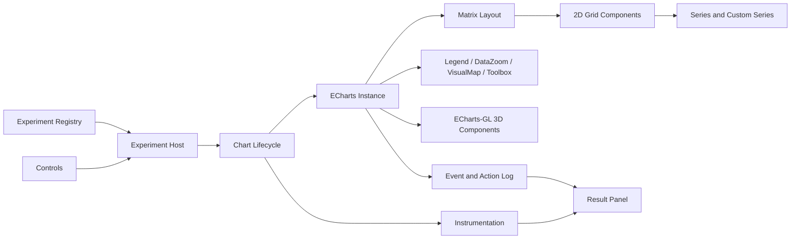

# ECharts Matrix Multi-Panel Chart Proof-of-Concept Technical Plan

## 1. Goal

Build a standalone application that determines how far native ECharts 6.1 matrix and ECharts-GL 2.1 capabilities can implement multi-panel interactive charts with shared and individual behavior.

This document is an external implementation brief. Its implementer must need only TypeScript, browser, and ECharts knowledge. No source code, terminology, data contracts, or architectural knowledge from another application may be assumed.

The PoC must answer three separate questions:

1. Can multiple 2D plots and their visual components be rendered by one ECharts instance?
2. Can the chart-family behavior defined in this document be provided through native ECharts configuration and actions?
3. Where native support ends, is a small workaround sufficient, or would the workaround recreate a complex application-level mediator?

The application must be understandable and runnable without access to the production codebase.

## 2. Evaluation Principles

1. Test native ECharts behavior before adding a workaround.
2. Separate matrix layout support from generic multi-grid support in one ECharts instance.
3. Separate core ECharts 2D support from ECharts-GL 3D support.
4. Use deterministic sample data so screenshots and measurements are repeatable.
5. Keep every experiment independently selectable and resettable.
6. Record observed behavior, ECharts option topology, and resource counts.
7. Do not infer support from documentation wording when a runnable test is possible.
8. Do not reproduce production abstractions, styles, or data contracts.
9. Implement each use case as an independently selectable example, even when examples reuse option builders or datasets.
10. For every element that can operate in shared or individual mode, expose a runtime scope control and demonstrate both modes.

## 3. Chart Families and Vocabulary

### 3.1 Chart families

The PoC evaluates three generic chart families. These definitions are complete; no product-specific meaning is required.

**Multi-panel Cartesian chart**

A matrix of independent 2D Cartesian plots. Each panel contains one or more ECharts `line` or `scatter` series, X/Y axes, an optional title, legend, tooltip, `dataZoom`, and toolbox. Panels may synchronize axis ranges, zoom windows, legend selection, and series-symbol visibility. They may also enlarge one panel temporarily.

**Bounded spatial overlay chart**

A matrix of 2D spatial plots drawn in value/value Cartesian coordinates. Each panel has a circular boundary with a small orientation notch, rectangular data regions, optional `scatter`, `lines`, and `custom` series, text labels, selected/unselected data-item styles, and continuous or piecewise `visualMap`. The circle is representative geometry, not required domain knowledge. Tests focus on geometry, color encoding, symbols, vectors, zoom, selection, and event routing.

**Compound spatial chart with marginal plots**

A matrix whose logical cell contains up to three Cartesian plots: one main bounded spatial plot, one optional line/scatter plot above it, and one optional line/scatter plot to its right. The top plot is an X-dimension marginal view and must always share the main plot's X domain and zoom. The right plot is a Y-dimension marginal view and must always share the main plot's Y domain and zoom. Optional plots may be absent independently. Tests focus on compound layout, alignment, fixed within-cell coupling, optional cross-cell sharing, and aspect ratio.

Each family also has a 3D profile where applicable. A 3D profile replaces the main 2D Cartesian spatial plot with ECharts-GL `grid3D` plus representative `scatter3D`, `line3D`, or `surface` series. Marginal plots remain 2D.

### 3.2 Required vocabulary

Use ECharts terms in source code, UI text, evidence, and reports:

| Use this term | Meaning |
| --- | --- |
| Example | One independently selectable and resettable configuration that answers one primary question |
| Chart family | One of the three generic compositions above |
| Logical cell | One matrix position; it may contain one plot or a compound group of plots |
| Plot | One Cartesian `grid` or ECharts-GL `grid3D` and its bound axes |
| Series | An ECharts `series` entry; do not call it a layer |
| Symbol | ECharts point-symbol rendering controlled by `symbol`, `symbolSize`, and related series options; do not call it a marker |
| Data item | One series datum or one rectangular region rendered by a `custom` series |
| Shared scope | One state or ECharts component targets all, one row, or one column of logical cells |
| Individual scope | Each logical cell owns independent state or ECharts components |
| Fixed coupling | A required synchronization that the user cannot switch to individual mode |

Names from any source application must not appear in code identifiers, navigation, screenshots, or scorecards. The PoC must describe behavior through the chart families and ECharts components defined here.

## 4. Versions and Project Setup

### 4.1 Required stack

- Node.js: current supported LTS
- TypeScript: current stable version supported by Vite
- Vite: current stable version
- ECharts: `6.1.x`, pinned to an exact version in the lockfile
- ECharts-GL: `2.1.x`, pinned to an exact version in the lockfile
- Playwright: current stable version for browser checks and screenshots
- Vitest: optional, for pure option-builder and state-transition tests

Use direct ECharts APIs. Do not use React chart wrappers or production chart factories.

### 4.2 Suggested project structure

```text
echarts-matrix-spike/
  package.json
  vite.config.ts
  playwright.config.ts
  src/
    main.ts
    styles.css
    app/
      experimentRegistry.ts
      experimentHost.ts
      controlPanel.ts
      resultPanel.ts
    core/
      chartLifecycle.ts
      optionSnapshot.ts
      instrumentation.ts
      measurement.ts
      eventLog.ts
      assertions.ts
    data/
      random.ts
      cartesianData.ts
      boundedSpatialData.ts
      compoundSpatialData.ts
      stressData.ts
    experiments/
      matrixFoundation.ts
      cartesianExamples.ts
      boundedSpatialExamples.ts
      compoundSpatialExamples.ts
      grid3DBoundary.ts
      multiInstanceBaseline.ts
      stressAndLifecycle.ts
    sharing/
      sharingMode.ts
      targetResolver.ts
      optionState.ts
    results/
      resultTypes.ts
      resultStore.ts
  tests/
    matrixFoundation.spec.ts
    cartesianSharing.spec.ts
    compoundComposition.spec.ts
    grid3D.spec.ts
    lifecycle.spec.ts
  evidence/
    screenshots/
    measurements/
    options/
    final-scorecard.md
```

### 4.3 Runtime architecture



Each one-instance experiment must execute exactly one `echarts.init`. The baseline experiment intentionally creates one instance per plot.

## 5. Capability Classification

Record one classification for every evaluated capability:

| Classification | Meaning |
| --- | --- |
| Native | Declarative ECharts option directly provides the behavior |
| Native with wiring | Public ECharts events/actions or option updates provide behavior without a custom synchronization framework |
| Workaround | External state, calculated layout, HTML controls, or manual event synchronization is required |
| Unsupported | Required behavior cannot be implemented reliably within spike constraints |
| Inconclusive | Evidence is insufficient or behavior is unstable |

Also record confidence:

- High: automated check and manual observation agree
- Medium: repeatable manual observation exists
- Low: documentation or one-off behavior only

## 6. Common Data and Grid Model

### 6.1 Logical identifiers

Use stable IDs rather than array indexes as the primary identity:

```typescript
type CellId = `row-${number}:column-${number}`;

interface CellDefinition {
  id: CellId;
  row: number;
  column: number;
  title: string;
  empty?: boolean;
}
```

Every ECharts component and series must have an `id` containing its logical cell ID, for example:

```text
grid/row-1:column-2/main
xAxis/row-1:column-2/bottom
series/row-1:column-2/temperature
legend/shared/main
```

This makes `setOption`, `replaceMerge`, events, screenshots, and logs traceable after insertion or deletion.

### 6.2 Deterministic datasets

Use a seeded pseudo-random generator. Include:

- Value/value line and scatter data
- Time/value line data using ISO 8601 timestamps
- Category/value data with ordered categories
- Multiple series and multiple Y axes
- Empty cells and cells with missing optional components
- Long axis, title, and legend labels
- Dense data for performance tests
- Circular boundary, orientation notch, rectangular regions, symbols, vectors, and labels
- Selected and unselected rectangular data items
- Continuous and discrete color-domain values
- 3D scatter, lines, and surface samples

Use the same generated datasets in one-instance and multi-instance comparisons.

### 6.3 Representative sizes

At minimum test:

- 1x1: feature correctness
- 2x2: ordinary comparison
- 3x3: sharing and layout complexity
- 5x5: resource and interaction stress
- 2x3 compound spatial chart: compound layout and aspect-ratio behavior

Test at these viewport classes:

- Wide desktop: approximately 1440x900
- Constrained desktop panel: approximately 900x650
- Narrow viewport: approximately 390x844

## 7. Application Shell

### 7.1 Example browser

Provide a searchable example browser grouped by Matrix Foundation, Multi-panel Cartesian, Bounded Spatial Overlay, Compound Spatial with Marginal Plots, ECharts-GL 3D, Export and State, Baseline, and Lifecycle. Every example listed in Section 8 must have its own route or stable example ID, Run button, Reset button, status, and evidence links.

Changing examples must dispose all active charts and verify no old canvas or WebGL context remains attached. Do not hide multiple primary questions behind one large demo screen.

### 7.2 Common controls

Provide controls for:

- Row and column count
- Renderer: Canvas or SVG for core 2D experiments
- Sharing scope for every supported element: Individual, All cells, Per row, and Per column where meaningful
- X-axis range and X `dataZoom` sharing
- Y-axis range and Y `dataZoom` sharing
- Z-axis range sharing where applicable
- Legend-selection sharing
- `visualMap` range/selection sharing
- Series visibility
- Series-symbol visibility
- Vector-scale and reference-vector-value sharing where vector series exist
- 2D/3D view-mode sharing where both modes exist
- 2D/3D view mode
- Zoom selected cell
- Restore all
- Regenerate deterministic data with displayed seed
- Add/remove a row or column
- Export image
- Start/stop measurement run

External controls are acceptable as application controls. Their existence must not be reported as a native ECharts capability.

Controls must be generated from each example's declared capabilities. A shareable element must never be silently fixed to shared or individual mode. Unsupported scopes must be disabled with a visible reason. Fixed coupling is allowed only for the compound-chart relationships defined in Section 3.1; render those controls disabled and labeled `Fixed: shared`.

### 7.3 Result panel

Always display:

- Experiment ID and data seed
- ECharts version and ECharts-GL version
- Number of `echarts.init` calls
- Number of live ECharts instances
- Number of canvas and SVG roots
- Number of WebGL contexts, where observable
- Latest event and target cell/component ID
- Latest action dispatched
- Current sharing modes
- Last `setOption` duration
- Last resize duration
- Current classification notes

### 7.4 Example contract

Register every example with explicit metadata:

```typescript
type SharingScope = 'individual' | 'all' | 'row' | 'column';

interface SharingCapability {
  element: 'xRange' | 'yRange' | 'zRange' | 'dataZoomX' | 'dataZoomY'
    | 'legendSelection' | 'visualMap' | 'seriesVisibility'
    | 'symbolVisibility' | 'vectorScale' | 'referenceVectorValue'
    | 'viewMode';
  supportedScopes: SharingScope[];
  defaultScope: SharingScope;
  fixed?: boolean;
  reason?: string;
}

interface ExampleDefinition {
  id: string;
  title: string;
  family: 'foundation' | 'cartesian' | 'bounded-spatial'
    | 'compound-spatial' | 'three-dimensional' | 'lifecycle';
  question: string;
  sharing: SharingCapability[];
  create(host: HTMLElement, seed: number): ExampleHandle;
}
```

`fixed: true` is valid only for main-to-top X coupling and main-to-right Y coupling in compound examples. All other capabilities that support more than one scope require an enabled runtime control.

## 8. Minimum Example Catalog

Each table row is one independently runnable example with its own stable ID, reset behavior, result, and evidence. Shared builders are encouraged, but examples must remain directly selectable. Additional focused examples may be added when an existing example cannot answer a question unambiguously.

### 8.1 Matrix foundation examples

| ID | Example and primary question |
| --- | --- |
| `M01` | Direct matrix-coordinate `scatter` series: can data render directly against matrix cells? |
| `M02` | Nested Cartesian grids: can four `grid` components occupy four matrix cells? |
| `M03` | Mixed axis types: do value, time, category, and multiple-axis plots remain isolated? |
| `M04` | Fixed and automatic sizing: how do row/column size rules affect nested plots? |
| `M05` | Headers, body labels, merged cells, and empty cells: which combinations remain valid? |
| `M06` | Component placement: can legend, toolbox, `dataZoom`, and `visualMap` use matrix box layout? |
| `M07` | Event routing: do click, double-click, hover, and context-menu identify the intended cell? |
| `M08` | Dynamic insertion/removal: do stable IDs prevent stale grids, axes, and series? |
| `M09` | Responsive resize: do all components remain inside their intended cells at three viewports? |
| `M10` | Native image export: are matrix labels and nested components present in `getDataURL` output? |

### 8.2 Multi-panel Cartesian examples

| ID | Example and primary question |
| --- | --- |
| `C01` | Independent line/scatter panels with individual axes and state |
| `C02` | X ranges: toggle Individual, All, Per row, and Per column |
| `C03` | Y ranges: toggle Individual, All, Per row, and Per column |
| `C04` | Mixed range scopes: shared X with individual Y, then individual X with shared Y |
| `C05` | Shared visible-axis representation versus synchronized independent axes |
| `C06` | X `dataZoom`: toggle Individual, All, Per row, and Per column |
| `C07` | Y `dataZoom`: toggle Individual, All, Per row, and Per column |
| `C08` | Selected-area zoom and reset across each supported scope |
| `C09` | Legend selection: toggle Individual, All, Per row, and Per column |
| `C10` | Series visibility: toggle Individual, All, Per row, and Per column |
| `C11` | Series-symbol visibility without hiding line rendering |
| `C12` | Multiple Y axes with compatible and incompatible sharing requests |
| `C13` | Tooltip and pointer-event routing to logical cell and series IDs |
| `C14` | Enlarge and restore one cell while preserving zoom, legend, and symbol state |
| `C15` | Add/remove rows and columns while preserving unaffected cell state |
| `C16` | Long labels, legends, sparse cells, and narrow viewport behavior |

### 8.3 Bounded spatial overlay examples

| ID | Example and primary question |
| --- | --- |
| `S01` | Circular boundary, orientation notch, and clipped rectangular `custom`-series data items |
| `S02` | Pixel-sized `scatter` symbols versus domain-sized `custom` shapes under zoom |
| `S03` | `lines` or `custom` vector rendering with scope toggles for vector scale and reference-vector value |
| `S04` | Continuous `visualMap`: toggle Individual, All, Per row, and Per column |
| `S05` | Piecewise `visualMap`: toggle Individual, All, Per row, and Per column |
| `S06` | X/Y range and `dataZoom` sharing using all supported scopes |
| `S07` | Legend, series visibility, and series-symbol visibility scope toggles |
| `S08` | Data-item click, double-click, context-menu, selection, and tooltip identity |
| `S09` | Aspect-ratio preservation, resize, clipping, and enlargement |
| `S10` | State persistence after data replacement, row/column changes, and reset |

### 8.4 Compound spatial examples

| ID | Example and primary question |
| --- | --- |
| `P01` | Main spatial plot only |
| `P02` | Main plus top marginal plot with fixed shared X range and X zoom |
| `P03` | Main plus right marginal plot with fixed shared Y range and Y zoom |
| `P04` | Main plus top and right marginal plots with both fixed couplings |
| `P05` | Alternating missing top/right plots without main-plot misalignment |
| `P06` | Matrix subregions for main, top, and right plot areas |
| `P07` | Multiple nested Cartesian grids within one matrix cell |
| `P08` | Calculated pixel-box fallback and resize stability |
| `P09` | Cross-cell main X/Y sharing scopes while within-cell coupling stays fixed |
| `P10` | Marginal value-axis sharing scopes independent of fixed dimension coupling |
| `P11` | Legend, `visualMap`, series, and symbol visibility scope toggles |
| `P12` | Wide and constrained 2x3 composition with long labels and legends |

### 8.5 ECharts-GL 3D examples

| ID | Example and primary question |
| --- | --- |
| `G01` | Attempt native matrix placement of one `grid3D` per cell |
| `G02` | Multiple absolute-positioned `grid3D` components in one ECharts instance |
| `G03` | Independent 3D camera interaction and event targeting |
| `G04` | Camera state: toggle Individual, All, Per row, and Per column |
| `G05` | X/Y/Z range, legend, and `visualMap` scope toggles for 3D series |
| `G06` | Bounded spatial 3D profile with representative `scatter3D`, `line3D`, and `surface` series |
| `G07` | Compound profile with one 3D main plot and optional 2D top/right marginal plots |
| `G08` | 2D/3D view mode: toggle Individual, All, Per row, and Per column without stale components or contexts |
| `G09` | Enlarge/restore 3D cell while preserving camera and visual state |
| `G10` | One-instance versus per-cell WebGL context and canvas counts |

### 8.6 State, export, baseline, and lifecycle examples

| ID | Example and primary question |
| --- | --- |
| `R01` | Export/import all sharing and interactive state into a fresh chart instance |
| `R02` | PNG export with Canvas, SVG, and ECharts-GL renderers where supported |
| `R03` | CSV and JSON export from the application data model |
| `R04` | Equivalent per-cell ECharts-instance baseline using the same seed and data |
| `R05` | Repeated initialization/disposal and example switching |
| `R06` | Rapid sharing-scope changes without event loops or duplicate handlers |
| `R07` | 1x1, 2x2, 3x3, and 5x5 resource and timing comparison |
| `R08` | Canvas/SVG and 2D/3D mode-switch cleanup |

### 8.7 Sharing coverage rule

For every sharing-capability declaration:

1. Provide a control for every supported scope.
2. Start an example in `individual` scope unless the relationship is fixed.
3. Change the element in one cell and assert exactly which cells changed.
4. Repeat after switching to each supported scope.
5. Switch back to `individual` and verify independent state can diverge again.
6. Record native ECharts target configuration, required event/action wiring, and unsupported scopes.

Only these relationships are fixed and omit individual behavior:

- Within one compound logical cell, main and top plots always share X range and X zoom.
- Within one compound logical cell, main and right plots always share Y range and Y zoom.

Cross-cell sharing remains toggleable for those dimensions.

## 9. ECharts Option Topology

### 9.1 Matrix foundation

Create one matrix component with row and column headers:

```typescript
const matrix = {
  id: 'matrix/main',
  left: 80,
  top: 60,
  right: 40,
  bottom: 60,
  x: { data: columnDefinitions },
  y: { data: rowDefinitions },
  body: { data: specialCells },
  triggerEvent: true,
};
```

For line and scatter plots, create one core `grid` per logical chart area:

```typescript
const grid = {
  id: `grid/${cell.id}/main`,
  coordinateSystem: 'matrix',
  matrixId: 'matrix/main',
  coord: [cell.column, cell.row],
  outerBoundsMode: 'same',
};
```

Bind each X/Y axis to its grid with `gridId` or `gridIndex`. Bind each series to explicit axis IDs or indexes. Avoid implicit first-component defaults.

The experiment must distinguish:

- A series using matrix as its data coordinate system
- A Cartesian `grid` using matrix only for box layout
- A series using Cartesian axes inside the matrix-positioned `grid`

Line series requires the third topology. Scatter and custom series must be tested both directly on matrix and inside nested Cartesian grids where meaningful.

### 9.2 Stable updates

Use stable component IDs for all arrays. Test both normal merge and explicit replacement:

```typescript
chart.setOption(nextOption, {
  notMerge: false,
  replaceMerge: ['grid', 'xAxis', 'yAxis', 'series', 'legend', 'dataZoom', 'visualMap'],
});
```

Do not assume this exact `replaceMerge` list is optimal. Compare it with ID-based normal merge and record which approach preserves interaction state while correctly removing obsolete cells.

## 10. Detailed Requirements: Matrix Foundation

### 10.1 Questions

- Can matrix size and position nested Cartesian grids correctly?
- Can rows and columns have fixed, percentage, and evenly distributed sizes?
- Can headers, body labels, merged cells, and empty cells coexist with nested charts?
- Can components be addressed by logical cell after dynamic updates?
- Does matrix correctly dispatch click, double-click, hover, and context-menu events?
- Does matrix remain stable during resize and renderer changes?

### 10.2 Test cases

1. Render a 2x2 matrix with four nested Cartesian grids.
2. Use one value/value, one time/value, one category/value, and one multiple-axis chart.
3. Give one row and one column explicit sizes; leave others automatic.
4. Hide headers using `x.show` and `y.show`, then use `x.length` and `y.length`.
5. Add a sparse empty cell.
6. Add matrix body labels and test merged body cells separately from chart cells.
7. Add a legend, toolbox, `dataZoom`, and `visualMap` laid out against matrix cells.
8. Add and remove a row through `setOption`.
9. Change row and column labels without recreating the chart.
10. Resize through `ResizeObserver` and call `chart.resize()` once per animation frame.
11. Export through `getDataURL` and verify headers and components are present.

### 10.3 Pass criteria

- Nested plots remain inside intended cells at all target viewports.
- Events identify the intended matrix coordinate or component ID.
- Dynamic updates remove obsolete elements without ghost series or axes.
- Export contains the complete expected view.
- No second ECharts instance is created.

## 11. Detailed Requirements: Multi-Panel Cartesian Charts

### 11.1 Required behaviors

- Multiple `line` and `scatter` series per cell
- Value, category, and time axes
- Multiple axes and top/bottom/left/right positions
- Runtime scope controls for visible-axis representation and axis ranges
- X-only, Y-only, and XY `dataZoom`
- Selected-area zoom and reset
- Runtime scope controls for legend selection
- Series-symbol visibility and reset
- Tooltip and click routing
- Per-cell title and row/column labels
- Zoom one logical cell and restore the matrix

### 11.2 Axis examples

Test these distinct models:

1. **Individual axes:** each nested grid owns visible X/Y axes.
2. **Synchronized ranges:** axes remain separate, but one `dataZoom` targets multiple axis indexes.
3. **Shared visible axis:** hide repeated cell axes and render one ECharts axis or custom shared-axis representation at the row/column boundary.
4. **Mixed sharing:** X shared and Y individual, then Y shared and X individual.

Do not label model 2 as a physically shared axis. It is a synchronized collection of axes unless one actual axis is demonstrably reused by multiple Cartesian systems.

Test compatibility failures:

- Different axis types
- Different axis positions
- Different number of axes
- Different category ordering
- Different time/value ranges

The PoC may disable a sharing toggle for incompatible cells. Record that as application validation, not ECharts-native validation.

### 11.3 Zoom examples

Create explicit `dataZoom` components targeting axis ID/index arrays:

- Shared X zoom across all cells
- Shared Y zoom across all cells
- Shared X zoom within a column only
- Shared Y zoom within a row only
- Individual cell zoom

Capture `datazoom` events and verify target axes. First prefer one `dataZoom` controlling multiple axes. Only if selective behavior is impossible, test event forwarding with `dispatchAction`.

For selected-area zoom, test toolbox `dataZoom`, captured selected ranges, reset, and whether one action can target multiple cell axes.

### 11.4 Legend examples

Test:

- One legend controlling same-named series across all cells
- Separate legend per cell
- Legends positioned in matrix cells
- Series names shared across some cells but not others
- Category-level legend behavior
- Initial selected state and runtime selection

Use unique series names when isolation is required. Use matching names intentionally when testing native cross-cell control. Record any naming constraint as a data-model implication.

### 11.5 Symbol and series visibility

Implement point rendering with built-in and custom ECharts symbols. Test circle, rectangle, and cross-like symbols, pixel sizing, opacity, fill, initial visibility, and scoped symbol visibility.

First test native legend selection or series option updates. If symbol-only visibility cannot be controlled without hiding lines, update the relevant series symbol options through `setOption` and classify as native with wiring.

### 11.6 Cell enlargement

Test two approaches:

1. Rebuild matrix sizes so the selected row/column consumes available space and hide unrelated components.
2. Temporarily set the selected nested grid to full-container box layout while retaining matrix state for restoration.

Verify interaction state survives enlargement and restore: data zoom, legend selection, axis ranges, and symbol visibility.

### 11.7 Pass criteria

- All sharing combinations update only intended cells.
- No event forwarding loop occurs.
- Shared zoom and legend behavior use native multi-target behavior where available.
- A selected cell can enlarge and restore without state loss.
- One ECharts instance renders all tested cells.

## 12. Detailed Requirements: Bounded Spatial Overlay Charts

### 12.1 Plot model

Use custom series and ordinary series to represent:

- Circular boundary and orientation notch
- Rectangular data regions
- Selected/unselected data-item states
- Scatter marks
- Positioned labels
- Vectors and fixed-value vectors
- Optional hardware shapes
- Continuous and piecewise color mapping

Use Cartesian axes because positions and dimensions are expressed in domain units. Use `custom.renderItem` with `api.coord` and `api.size` for domain-sized rectangles and shapes.

### 12.2 Geometry checks

- Preserve square ratio when configured.
- Test ratio based on X/Y axis domain when both axes are compatible value axes.
- Clip elements at grid boundaries.
- Keep pixel-sized marks constant during data zoom.
- Scale domain-sized marks with axes.
- Validate point, circle, rectangle, and cross-like mark geometry.
- Verify vector endpoints, weight, and scale changes.

### 12.3 Sharing controls

Provide runtime sharing-scope controls for:

- X and Y ranges/zoom
- Legend
- Continuous `visualMap`
- Piecewise `visualMap`
- Series-symbol visibility
- Vector scale
- Fixed reference-vector value

ECharts has no general numeric input component for vector scale or reference-vector value. Implement these as external HTML controls that update series data/options. Classify the rendering response separately from the control UI.

### 12.4 Data-item interaction

Test:

- Tooltip built from data-item values
- Click and double-click with logical cell and data-item identity
- Toggle data-item selection
- Context-menu event and action identity
- Disabled event mappings for selected data items
- Selection persistence after zoom, resize, and data update

### 12.5 Pass criteria

- Geometry remains correct under zoom and resize.
- Shared color and zoom changes affect intended cells only.
- Events preserve logical-cell and data-item identity.
- External inputs do not require additional ECharts instances.
- One ECharts instance renders the complete 2D grid.

## 13. Detailed Requirements: Compound Spatial Charts

### 13.1 Required composition

Each logical cell may contain:

- One main bounded spatial plot
- One optional top Cartesian line/scatter plot
- One optional right Cartesian line/scatter plot
- Main and auxiliary axes
- Main and auxiliary legends
- Per-cell title and controls

Marginal plots may be sparse. Their presence must not misalign neighboring main plots.

### 13.2 Layout approaches

Test in order:

1. **Matrix subregions:** represent main, top, and right plot areas as additional matrix rows/columns with grouped headers.
2. **Multiple nested grids in one matrix cell:** determine whether separate core grids can use the same matrix coordinate with local box offsets or bounds.
3. **Calculated pixel boxes:** obtain cell geometry with `convertToPixel` or matrix coordinate APIs, then set nested grid rectangles explicitly.

Approach 3 is a workaround. Measure its resize and update complexity before accepting it.

### 13.3 Sharing relationships

The following within-cell relationships are mandatory and have disabled controls labeled `Fixed: shared`:

- Main plot X range and X zoom are synchronized with the top marginal plot.
- Main plot Y range and Y zoom are synchronized with the right marginal plot.

Provide runtime scope controls across logical cells for:

- Main X and Y ranges and zoom
- Top marginal Y range and right marginal X range
- Main and marginal legend selection
- Main `visualMap` state
- Series visibility and series-symbol visibility

Verify that a state change cannot leak from the top component into unrelated right-component dimensions.

### 13.4 Sparse and asymmetric cases

Include:

- All auxiliary plots present
- No auxiliary plots
- Top plots only
- Right plots only
- Alternating missing top/right plots
- Different legend lengths
- Long labels
- 2 columns x 3 rows in a wide and constrained container

### 13.5 Pass criteria

- Main plots align and preserve required aspect ratio.
- Sparse auxiliary plots do not create unexplained gaps.
- Shared dimensions synchronize correctly across component types.
- Compound layout resizes without oscillation or overlap.
- Any pixel-layout workaround has bounded and understandable code.

## 14. Detailed Requirements: ECharts-GL 3D Boundary

### 14.1 Native matrix placement test

Official ECharts-GL `grid3D` options expose absolute box layout but do not document core matrix fields. Test whether these fields are accepted and honored:

```typescript
{
  coordinateSystem: 'matrix',
  matrixId: 'matrix/main',
  coord: [column, row]
}
```

Use runtime output, rendered positions, and option inspection. If ignored, classify matrix placement as unsupported rather than relying on TypeScript casts.

### 14.2 One-instance absolute layout fallback

Inside one ECharts instance, create multiple `grid3D`, `xAxis3D`, `yAxis3D`, and `zAxis3D` components with explicit pixel or percentage boxes.

Test the common 3D foundation:

- Independent 3D scatter, lines, and surface data
- Independent camera rotation, pan, and zoom
- Camera sharing scopes through public or observed ECharts-GL events/actions
- Runtime sharing-scope controls for `visualMap` and legend selection
- Resize and cell enlargement
- 2D/3D mode switching
- Disposal and context cleanup

Keep native matrix failure separate from successful one-instance absolute positioning.

### 14.3 Chart-family 3D profiles

After the common 3D foundation, run two explicit profiles so the final report can make separate chart-family verdicts.

**Bounded spatial 3D profile**

- Render representative 3D scatter, line, vector, and surface series where supported.
- Provide sharing-scope controls for X/Y/Z ranges and camera state.
- Test legend, continuous/piecewise color scale, symbol visibility, vector scale, tooltip, and selection behavior.
- Switch each logical cell between equivalent 2D and 3D data without leaking old components or contexts.
- Verify a cell can enlarge and restore while preserving its camera and visual state.

**Compound spatial 3D hybrid profile**

- Render the main bounded spatial plot in 3D while top and right marginal plots remain 2D.
- Position one main `grid3D` plus optional top/right core Cartesian grids for each logical cell.
- Test main X/Y/Z and camera sharing independently from marginal value-axis sharing; keep required within-cell X/Y coupling fixed.
- Verify sparse top/right components remain aligned with absolute-positioned 3D main plots.
- Test color scale, view mode, symbol visibility, legend, tooltip, and data-item selection.
- Switch main plots between 2D and 3D while retaining auxiliary plot state.

If a required series has no equivalent ECharts-GL series, use the nearest representative series only to evaluate layout, interaction, sharing, and resource behavior. Record rendering parity as untested rather than supported.

### 14.4 WebGL instrumentation

Instrument `HTMLCanvasElement.prototype.getContext` before ECharts initialization and count requests and unique returned contexts for:

- `webgl`
- `experimental-webgl`
- `webgl2`

Restore the original function when instrumentation ends. Also listen for `webglcontextlost` and `webglcontextrestored`.

Run equivalent one-instance and per-cell-instance scenarios. Record contexts, canvases, warnings, failed rendering, and interaction isolation.

### 14.5 Pass criteria

- Matrix support receives an explicit supported/unsupported result.
- Absolute multi-`grid3D` fallback renders correctly or receives an explicit failure result.
- Camera interaction targets the intended 3D viewport.
- Bounded spatial 3D and compound spatial 3D hybrid profiles each receive separate capability results.
- WebGL-context count and cleanup are observed and recorded.

## 15. Runtime Sharing Scope Behavior

### 15.1 State model

Keep a plain serializable application state:

```typescript
interface SharingState {
  xRange: SharingScope;
  yRange: SharingScope;
  zRange: SharingScope;
  dataZoomX: SharingScope;
  dataZoomY: SharingScope;
  legendSelection: SharingScope;
  visualMap: SharingScope;
  seriesVisibility: SharingScope;
  symbolVisibility: SharingScope;
  vectorScale: SharingScope;
  referenceVectorValue: SharingScope;
  viewMode: SharingScope;
  camera: SharingScope;
}
```

Keep interactive state separately:

- Axis ranges
- Data-zoom windows
- Legend selections
- Series visibility
- Series-symbol visibility
- Color-scale range
- Vector scale and reference-vector value
- 2D/3D view mode
- Per-cell selection
- 3D camera state
- Enlarged cell ID

### 15.2 Toggle procedure

For each element and every supported scope:

1. Capture relevant state with `getOption` or maintained application state.
2. Change sharing scope.
3. Rebuild only affected ECharts components.
4. Apply a deterministic conflict policy when moving individual state to shared state.
5. Remove stale individual/shared components.
6. Verify event handlers are not duplicated.
7. Verify unrelated state remains unchanged.

Test conflict policies separately:

- Use first cell state
- Use configured grid-level initial state
- Reset to data-derived state

The PoC must report which policy it uses. ECharts does not choose application sharing policy.

## 16. Export and Persistence

### 16.1 Native image export

Test:

- `getDataURL` for PNG
- Canvas and SVG renderers
- Matrix headers and all nested charts
- Legends, toolboxes, and visual maps
- Enlarged-cell mode
- ECharts-GL output

### 16.2 Application exports

CSV and raw JSON export are not matrix capabilities. Implement a small data-model export to prove they remain independent of chart instance count:

- CSV grouped by row label, column label, and cell title
- Raw deterministic input JSON

Classify these as application features unaffected by matrix.

### 16.3 State snapshot

Provide an Export State button that serializes sharing state and interactive state. Provide Import State and verify restoration after a fresh chart initialization.

## 17. Lifecycle and Stress

Test:

1. Initialize and dispose each experiment 20 times.
2. Switch experiment tabs repeatedly.
3. Add and remove rows and columns.
4. Change sharing scopes rapidly.
5. Resize the host repeatedly.
6. Replace small data with stress data and back.
7. Switch Canvas/SVG where supported.
8. Switch 2D/3D where supported.
9. Remove all cells and restore them.
10. Force or simulate WebGL context loss where browser support permits.

After disposal verify:

- `echarts.getInstanceByDom(host)` returns no old instance
- No detached experiment canvas remains in the host
- Resize observers and event listeners stop producing logs
- Live instrumentation count returns to expected baseline

## 18. Instrumentation and Measurement

### 18.1 Metrics

Capture:

- Cold initialization duration
- First finished-render duration
- `setOption` duration
- Data update duration
- Sharing-toggle duration
- Resize duration
- Cell-enlargement and restore duration
- Live ECharts instances
- Canvas/SVG element count
- WebGL context count
- DOM node count in experiment host
- Heap measurements when browser APIs permit
- Long tasks and console warnings

### 18.2 Measurement protocol

1. Use production-mode builds.
2. Record browser, OS, CPU, memory, renderer, pixel ratio, grid size, point count, and seed.
3. Warm up once, then run at least five measured iterations.
4. Report median and observed range.
5. Run one-instance and multi-instance baselines in the same browser session.
6. Avoid claiming universal performance thresholds from one machine.

### 18.3 Correctness before performance

Do not compare performance for an experiment that fails functional acceptance. Mark the result as non-equivalent instead.

## 19. Automated Browser Checks

Use Playwright for high-value deterministic checks:

- Experiment loads without page or console errors.
- Expected number of ECharts instances exists.
- Matrix cell click reports correct row/column.
- Shared X zoom changes all intended X axes and no unintended Y axes.
- Individual zoom changes one cell only.
- Legend selection affects expected series.
- Symbol-visibility toggle preserves line rendering.
- Data-item selection persists after resize.
- Enlarged cell fills expected area and restores.
- Sparse compound layout has no overlap.
- 3D canvases contain non-background pixels.
- Export returns a non-empty image.
- Disposal removes instances and visual roots.

Capture screenshots before and after resize, sharing toggles, cell enlargement, and 2D/3D switching.

## 20. Native Capacity Scorecard

Maintain a row for every capability:

| Attribute | Description |
| --- | --- |
| Capability ID | Stable identifier, such as `LSG-ZOOM-01` |
| Capability | User-observable or architectural behavior |
| Applies to | Multi-panel Cartesian, bounded spatial 2D/3D, or compound main/top/right plots |
| Experiment | Reproducible experiment and control settings |
| Native API | ECharts option, event, action, or `None` |
| Classification | Native, Native with wiring, Workaround, Unsupported, Inconclusive |
| Confidence | High, Medium, Low |
| Evidence | Screenshot, event log, option snapshot, or measurement file |
| Limitation | Lost behavior, data constraint, or layout constraint |
| Complexity | Low, Medium, High |

Minimum scorecard areas:

- Matrix layout and dynamic cells
- Responsive resize and aspect ratio
- Axis sharing scopes
- Axis types, positions, labels, units, inversion, and ranges
- Multiple axes
- Data-zoom sharing scopes
- Selected-area zoom and reset
- Legend-selection sharing scopes
- Series and symbol visibility
- Continuous and piecewise visual maps
- Vector scaling and reference vectors
- Cell selection and event routing
- Cell enlargement
- Compound logical cells
- Sparse auxiliary plots
- 2D/3D switching
- Multiple 3D views
- Image export
- State restoration
- Lifecycle and disposal

## 21. Final Decision Method

Produce one verdict per target:

- Multi-panel Cartesian charts
- Bounded spatial overlay charts in 2D
- Bounded spatial overlay charts in 3D
- Compound spatial charts in 2D
- Compound spatial charts with a 3D main plot and 2D marginal plots

Allowed verdicts:

1. **One instance feasible:** required capabilities pass; gaps are low-complexity wiring.
2. **Hybrid reduction feasible:** substantial reduction is possible, but defined components or modes require separate instances.
3. **Not advisable:** required behavior is unsupported or workarounds recreate comparable complexity/risk.

For each verdict report:

- Supported and unsupported capability summary
- Native versus workaround proportion
- Current conceptual instance model
- PoC instance and WebGL-context model
- Functional compromises
- Data-model constraints
- Layout and resize complexity
- Sharing and state complexity
- Export implications
- Performance observations
- Integration risks
- Recommended next experiment or production-design step

## 22. Stop Conditions

Stop an experiment and report it as blocked when:

- Required ECharts component cannot be placed or addressed reliably.
- Public events/actions cannot identify or update the intended cell.
- A workaround requires a general publish/subscribe mediator comparable to the current architecture.
- Resize depends on unstable timing or repeated layout convergence.
- One-instance rendering produces unacceptable interaction leakage.
- ECharts-GL creates context or viewport behavior that cannot be isolated.

Do not hide a stop condition by expanding the PoC into production infrastructure.

## 23. Definition of Done

The PoC is complete when:

- All experiments are runnable from one standalone application.
- Every required capability has a scorecard classification.
- High-risk conclusions have executable evidence.
- One-instance and multi-instance baselines use equivalent datasets.
- 2D matrix support and 3D ECharts-GL support are reported separately.
- Workarounds are isolated and clearly labeled.
- Resource and timing observations include environment details.
- Each target chart family and dimensional profile has a verdict and rationale.
- Unknown or inconclusive results remain explicit.

## 24. Official References

- ECharts matrix options: https://echarts.apache.org/en/option.html#matrix
- ECharts 6 feature overview: https://echarts.apache.org/handbook/en/basics/release-note/v6-feature/
- Matrix sparkline example: https://echarts.apache.org/examples/en/editor.html?c=matrix-sparkline
- Core Cartesian grid options: https://echarts.apache.org/en/option.html#grid
- Data zoom options: https://echarts.apache.org/en/option.html#dataZoom
- Legend options: https://echarts.apache.org/en/option.html#legend
- Visual map options: https://echarts.apache.org/en/option.html#visualMap
- ECharts-GL grid3D options: https://echarts.apache.org/en/option-gl.html#grid3D
